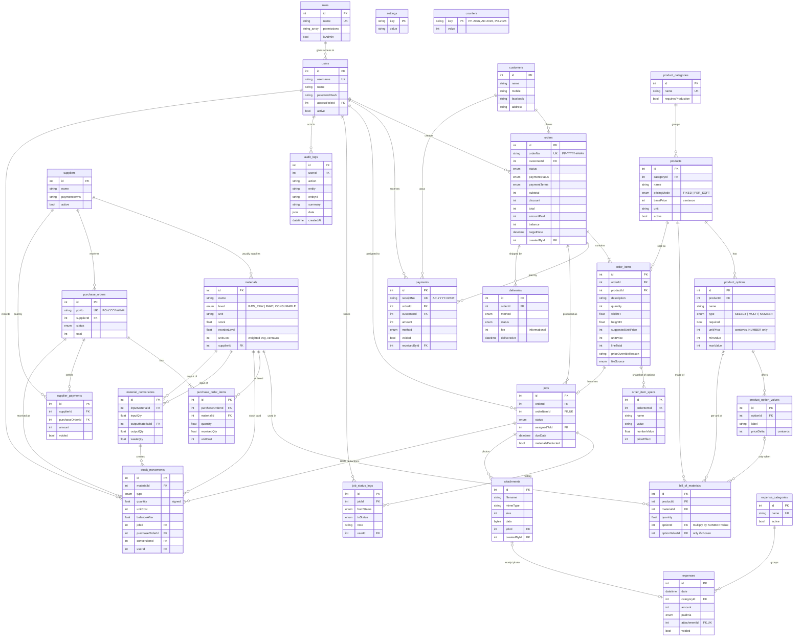
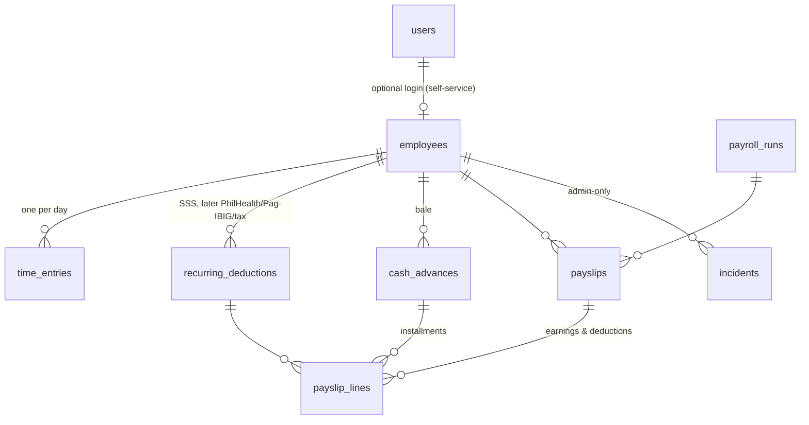

# Paper & Pixels — Data model (ERD)

The source of truth is [`prisma/schema.prisma`](../prisma/schema.prisma). This page is the
picture and the reasoning behind it. Table names below are the real PostgreSQL table names.

## Diagram

## Tables

| Table | What it holds |
|---|---|
| `users` | Logins. `accessRoleId` → `roles` decides what they can open (the old `role` enum column is kept only for history: ADMIN or STAFF). Deactivated users can't log in; their history stays. |
| `roles` | Access roles made by the owner: `permissions` is a list of module keys (see `src/lib/permissions.ts`); `isAdmin` marks the locked Admin (owner) role with full access. |
| `settings` | Key/value shop settings: name, address, contact, Facebook, email, receipt footer, `bom_deduct_on`. |
| `counters` | One row per document type and year (`PP-2026`, `AR-2026`, `PO-2026`) holding the last number used. |
| `audit_logs` | Who did what, when: every create/update/void/cancel/status change/override/login, with optional JSON details. |
| `attachments` | Small files (job progress photos, expense receipts) stored as bytes in the DB. |
| `customers` | Name, mobile, Facebook name/link, email, address, notes. Balance is computed from their orders. |
| `suppliers` | Who we buy from, payment terms, contact. |
| `product_categories` | Wedding Album, Picture Frame, Printing Press, Photo Printing. `requiresProduction` decides if order lines become jobs. |
| `products` | Price-list items. `basePrice` is per piece (FIXED) or per sq ft (PER_SQFT). |
| `product_options` / `product_option_values` | The configurable parts of a product (cover type, size, number of leaves, add-ons) and their price effects. |
| `bill_of_materials` | Materials used per unit of product, optionally per numeric option or only for a chosen value. |
| `orders` | Job order header: customer, status, payment terms/status, totals, target date, cancel/delivery info. |
| `order_items` | Order lines: product, qty, size (sq-ft items), suggested vs actual unit price + override reason, specs notes, file source. |
| `order_item_specs` | Frozen copy of the options chosen on each line and what each added to the price. |
| `payments` | Customer payments with official receipt number (AR), method, reference; voided instead of deleted. |
| `jobs` | Production board cards — one per order line in a production category; assignee, status, due date. |
| `job_status_logs` | Status changes and progress notes for a job (from/to null = note only). |
| `materials` | Inventory items at three levels (raw-raw, raw, consumable) with stock, reorder level, weighted-average cost. |
| `stock_movements` | Stock card: every stock change, signed quantity, cost and running balance, linked to the job/PO/conversion that caused it. Stock-outs record `releasedToId`: the production worker who received the material. |
| `material_conversions` | Cutting raw-raw into raw stock, e.g. 1 PVC sheet 4x8 → 32 pcs 12x12. |
| `purchase_orders` / `purchase_order_items` | Orders to suppliers and how much of each line has been received. |
| `supplier_payments` | Payments to suppliers, optionally against a PO; voided instead of deleted. |
| `expense_categories` / `expenses` | Day-to-day shop expenses with optional receipt photo. |
| `deliveries` | Pickup/Lalamove/LBC/own delivery records, rider, tracking, fee, status. |

## Design decisions

1. **Money is integer centavos** (`Int`): ₱1,234.50 is stored as `123450`. No floating-point rounding errors in totals, balances or reports.
2. **Material quantities are `Float` rounded to 3 decimals** (2.5 sheets, 0.25 roll, 120 ml) — every write goes through `round3()`.
3. **Gap-free document numbers via the `counters` table**, incremented with an `INSERT … ON CONFLICT DO UPDATE` *inside the same transaction* that inserts the record. Formats: `PP-YYYY-#####` (orders), `AR-YYYY-#####` (receipts), `PO-YYYY-#####` (purchase orders). The key includes the year, so numbering resets every January (Manila time). A failed save rolls back the counter too, so numbers are never skipped or reused.
4. **Roles are rows in `roles`** with a list of module permissions, editable by the owner. Permissions are read from the database on every request (not stored in the login token), so changes apply immediately. The Admin role is locked to full access so the owner can never be locked out.
5. **Option-based pricing**: unit price = base price + chosen SELECT/MULTI value deltas + (NUMBER value × option unit price). For PER_SQFT products the base price is per sq ft and is multiplied by width × height (feet). The same pure function (`computeUnitPrice`) runs in the POS screen and on the server.
6. **`order_item_specs` is a snapshot**: option names, labels and price effects are copied onto the order line, so editing the price list never changes old orders or receipts. Price overrides keep both the suggested and actual price plus a required reason.
7. **Jobs = one per order line whose category requires production.** Photo printing (walk-in) lines don't create jobs.
8. **`job_status_logs` also holds progress notes** (from/to status null), so one timeline shows everything that happened to a job.
9. **BOM formula**: quantity used = BOM qty × line qty × (area in sq ft if PER_SQFT) × (numeric option value if the BOM line is tied to a NUMBER option); lines tied to an option value only apply when that value was chosen. Deducted once per job, when the job reaches the status set in Settings (`In Process` or `Completed`). Stock may go negative (work never stops) — low-stock alerts show it.
10. **Weighted-average unit cost**: each stock-in recomputes `unitCost = (old qty × old cost + in qty × in cost) / (old qty + in qty)`.
11. **Conversions value the output at the input's cost**: output unit cost = (input qty × input unit cost) / output qty, so cutting a sheet doesn't create or lose value; waste is recorded for information.
12. **Supplier payable = value of received PO items − non-voided supplier payments.** Unreceived items are not owed yet.
13. **Delivery fee is informational** — it is not added to the order total (customers usually pay the rider directly).
14. **Attachments are stored in the database (`bytea`)**, resized on the phone before upload, so the single daily database backup also covers job photos and receipt pictures.
15. **Nothing financial is deleted.** Orders are cancelled, payments/expenses/supplier payments are voided — always with a reason — and reports exclude them.
16. **`audit_logs` is generic** (action, entity, entityId, summary, JSON data): one table covers every module without schema changes. Password hashes are never logged.

## HR, timekeeping & payroll (added)

| Table | Purpose |
|---|---|
| `employees` | Profile, pay type (DAILY rate / MONTHLY salary, centavos), pay frequency (WEEKLY / SEMI_MONTHLY), schedule (shift start/end, break, work days), gov't ID numbers, bcrypt **time-clock PIN** (+ lockout counters), optional `userId` for self-service. Numbered `EMP-0001`. |
| `time_entries` | Daily time record, unique per employee + day. Time in/out, break, day type (regular, rest day, special/regular holiday, paid leave), source (clock / manual), **OT approved** flag, and computed regular / late / undertime / overtime minutes. |
| `holidays` | Holiday calendar (regular / special) used to set day types and holiday pay. |
| `recurring_deductions` | Fixed per-employee deductions with schedule *every payroll* or *once a month*. |
| `cash_advances` | Amount, installment per payroll, running balance; repaid when a payroll run is finalized (reversed if voided). |
| `payroll_runs` | `PR-YYYY-#####`, period, pay date, status DRAFT → FINALIZED → PAID (or VOID), totals; `expenseId` of the Salaries expense created when paid. |
| `payslips` / `payslip_lines` | Per-employee result with snapshot of rate & attendance; lines are EARNING or DEDUCTION with a code (BASIC, ABSENCES, LATE_UNDERTIME, OVERTIME, REST_DAY, HOLIDAY, LEAVE, RECURRING, CASH_ADVANCE, MANUAL). Manual lines survive recalculation. |
| `incidents` | Incidents, violations, warnings — **admin-only**, never queried by employee-facing pages. |

Design decisions: pay rules live in one place (`src/lib/payroll.ts`), time rules in `src/lib/timekeeping.ts`; overtime is paid only when approved; net pay can't go negative (cash-advance installments are reduced instead); finalized runs are locked and time records inside them can't be edited.
